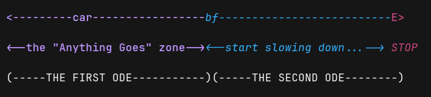
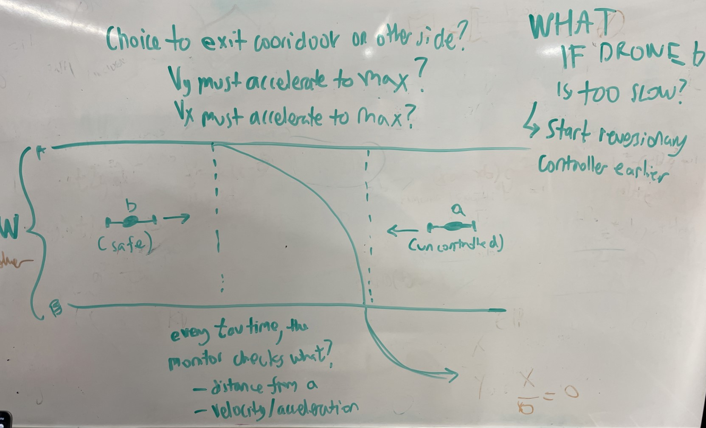

# Formally Verifying UAS Safety with Differential Dynamic Logic

> Formal Verification Research Intern @ NASA Langley Research Center w/ the
> Formal Methods team. \
> Mentors: J. Tanner Slagel, Cesar Muñoz

📄 **[Read the final research paper (PDF)](Nicolas%20Crespo%20Final%20Research%20Paper.pdf)** ·
📚 **[Co-authored publications](#publications)**

Autonomous unmanned aircraft systems (UAS), like drones used for wildfire
prevention and disaster response, are increasingly flown by untrusted AI-based
controllers. Their safety systems need to work under every possible condition,
not just the ones that come up in testing. During my internship, I designed two
fallback systems for autonomous aircraft, braking and collision avoidance, and
modeled them as hybrid programs (software control mixed with continuous physics)
in Differential Dynamic Logic (dL). I then used the KeYmaera X and PVS theorem
provers to build formally verified proofs about how they behave. The work
follows the Runtime Assurance (RTA) pattern, where an untrusted controller runs
freely while a monitor watches it and hands control to a verifiably safe
fallback controller once danger is detected.

## 1. Dynamic Braking System

A drone (or car, as labeled in the image) flies toward a fixed barrier at
position $E$. Before reaching the boundary $bf$ it can move however it likes.
Once it reaches $bf$, a reversionary controller takes over and applies a
deceleration it computes from the drone's speed at that moment, so that it stops
exactly at the barrier $E$.

Theorem (proved):

$$
x \le bf \land bf < E \land a > 0 \land v > 0 \;\rightarrow\; \\
\Big\langle \big( \{x' = v,\ v' = a \ \&\ x \le bf\} \;\cup\;
(?x = bf;\ v_i := v;\ \{x' = v,\ v' = -\tfrac{v_i^2}{2(E - bf)} \ \&\ x \ge bf\}) \big)^{*} \Big\rangle
\,(x = E \land v = 0)
$$

In other words, from any valid starting state, there exists a way for the system
to run such that the drone comes to rest exactly at the barrier.

### Proof

- I unrolled the control loop into the two phases of a successful run:
  accelerate up to the boundary, then brake.
- I derived the exact length of each phase from the equations of motion and
  gave these times to the prover as witnesses:
  - time to reach the boundary: $t_1 = \frac{\sqrt{v^2 + 2a(bf - x)} - v}{a}$
  - time to stop: $t_2 = \frac{2(E - bf)}{v_i}$
- Real-arithmetic quantifier elimination closed the remaining goals.
- An earlier attempt got stuck when the prover (through Wolfram) found a
  counterexample
  ([screenshot](src/RTA_Examples/braking/counterexample_wolfram.png)). It showed
  that my proof was missing some preconditions on velocity and acceleration. After
  fixing that, the proof passed.

Relevant files:

- [complete proof in KeYmaeraX](src/RTA_Examples/braking/automated_braking.kyx)
- [stuck attempt](src/RTA_Examples/braking/automatic_braking_stuck.kyx)
- [PVS / Plaidypvs version (in progress)](src/RTA_Examples/braking/automated_braking.pvs)

## 2. Productive Collision Avoidance

Two drones fly toward each other down a corridor. Drone B moves arbitrarily.
When the monitor on Drone A sees B within a critical distance, Drone A's
fallback controller steers it out of the corridor, around B, and back onto its
original path. The avoidance is intentionally productive, meaning Drone A keeps
working toward its mission goal during the maneuver instead of just stopping or
retreating. Because every drone always veers the same way, giving all drones in
an airspace this behavior avoids head-on collisions as long as each drone
behaves as specified.

### My Work

- I designed the scenario, the monitor's trigger conditions, and the fallback
  maneuver.
- I derived the minimum separation distance at which Drone A must start evading
  to clear the corridor safely. I worked it out from the kinematic equations,
  first assuming constant forward velocity and then for the general accelerating
  case (see the paper, pp. 9–10).
- Identified the proof techniques the full proof will need: differential
  invariants and differential ghosts, which reason about the motion without the
  potentially computationally expensive step of solving the drones' differential
  equations.

## Publications

This internship was part of NASA's research on a formal verification framework
for Runtime Assurance. I co-authored two papers describing that framework:

- _A Verification Framework for Runtime Assurance of Autonomous UAS_\
  A. T. Slagel, L. M. White, A. Dutle, C. A. Muñoz, N. Crespo.
  _2024 AIAA DATC/IEEE 43rd Digital Avionics Systems Conference (DASC)_, Nov 2024.
  [doi.org/10.1109/DASC62030.2024.10748654](https://doi.org/10.1109/DASC62030.2024.10748654)
- _A Formal Verification Framework for Runtime Assurance_\
  A. T. Slagel, L. M. White, A. Dutle, C. A. Muñoz, N. Crespo.
  _NASA Formal Methods: 16th International Symposium (NFM 2024)_, Springer, May 2024, pp. 322–328.
  [doi.org/10.1007/978-3-031-60698-4_19](https://doi.org/10.1007/978-3-031-60698-4_19)

## Tools and Setup

- Theorem provers: [KeYmaera X](https://keymaerax.org/) (Carnegie Mellon) and
  [PVS](https://pvs.csl.sri.com/) with Plaidypvs, NASA's embedding of dL in PVS
- Formal methods: Differential Dynamic Logic, hybrid systems, sequent
  calculus, loop invariants, differential invariants and ghosts
- Math: ODEs and kinematics, real arithmetic and quantifier elimination
- Environment: Linux VM setup for PVS (on Apple Silicon), Emacs, VSCode-PVS

## Other Notes

I also documented everything I learned about using dL in PVS, written for future
interns picking up the same tools:

- [Index](INDEX.md): a guide to dL in PVS, linking to every note in [pages/](pages/)
- [Journals](journals/) and [Mentorship Hour Log](Mentorship-Hour-Log.md): daily entries from throughout the internship
- [Practice models](src/): bang-bang controller, cooling, and car-following examples
- See the dL library source and more examples in [nasalib](https://github.com/nasa/pvslib/blob/master/dL/README.md)

---

This is personal research work from an internship and is not an official
NASA product.
